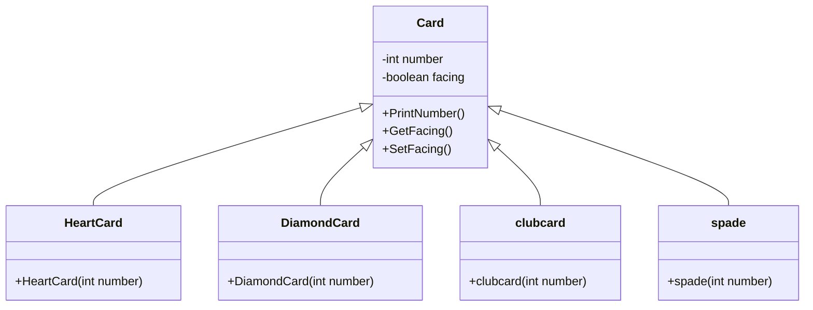

# ♠️ Blackjack Card Simulation — Java Inheritance & Polymorphism

<p align="center">
  
</p>

<p align="center">
  A Java object-oriented demonstration modeling playing card decks, suit variations, state encapsulation (facing orientation), and polymorphic behaviors using class inheritance hierarchies.
</p>

<p align="center">
  <a href="https://github.com/prakruthidevanga/Prakruthi_BlackJack">
    
  </a>
</p>

<p align="center">
  
  
  
  
</p>

---

## 📌 Table of Contents

- [📖 Project Overview](#-project-overview)
- [🎯 Objectives](#-objectives)
- [✨ Key Features](#-key-features)
- [🏗️ OOP Class Hierarchy](#️-oop-class-hierarchy)
- [🛠️ Technology Stack](#️-technology-stack)
- [📁 Repository Structure](#-repository-structure)
- [⚙️ Compilation and Execution](#️-compilation-and-execution)
- [🔮 Future Enhancements](#-future-enhancements)
- [🤝 Contributing](#-contributing)
- [👩‍💻 Author & Accreditations](#-author--accreditations)

---

## 📖 Project Overview

Inheritance and polymorphism allow software systems to model families of related entities sharing common state while expressing specialized behaviors. In card games, cards share core numerical attributes and orientation states, while belonging to distinct suit classifications.

**Prakruthi Blackjack** demonstrates this class hierarchy in Java. A foundational `Card` base class encapsulates core states (`number`, `facing`), while specialized subclasses (`HeartCard`, `DiamondCard`, `clubcard`, `spade`) extend the base class. A driver program dynamically builds a 52-card deck array and iterates through face-up cards polymorphically.

♠️ **Core Mission:** Provide a clear, object-oriented demonstration of class inheritance and method overriding in Java.

---

## 🎯 Objectives

- 🃏 **Base Class Abstraction:** Encapsulate common card properties (`number`, `facing` orientation) inside a reusable base class.
- 🌳 **Class Inheritance Trees:** Extend `Card` into distinct suit subclasses (`HeartCard`, `DiamondCard`, `clubcard`, `spade`).
- 🔄 **Array Deck Population:** Programmatically populate a fixed-length 52-card array using iterative suit partitioning.
- 👁️ **State Checking:** Query boolean card orientation (`GetFacing()`) before invoking print operations.

---

## ✨ Key Features

### 🎴 1. Base `Card` Class
Defines underlying private instance variables, constructor overloads, and accessor methods (`GetFacing()`, `SetFacing()`, `PrintNumber()`).

### ♣️ 2. Four Suit Subclasses
Implements `HeartCard`, `DiamondCard`, `clubcard`, and `spade` extending the base class with suit-specific constructors.

### 🔄 3. Iterative Deck Builder
Algorithmically partitions a 52-element `Card[]` array, allocating 13 cards per suit using modulo arithmetic and switch branching.

---

## 🏗️ OOP Class Hierarchy



---

## 🛠️ Technology Stack

<p align="center">
  
</p>

| Component | Technology | Implementation Role |
| :--- | :--- | :--- |
| **Language** | Java (JDK 8 or higher) | Class definitions, inheritance (`extends`), and arrays |
| **Paradigms** | OOP (Encapsulation, Polymorphism) | Modular class design and subtyping |

---

## 📁 Repository Structure

```text
Prakruthi_BlackJack/
├── Card.java          # Base card class with facing state and value logic
├── HeartCard.java     # Subclass extending Card for Heart suit
├── DiamondCard.java   # Subclass extending Card for Diamond suit
├── clubcard.java      # Subclass extending Card for Club suit
├── spade.java         # Subclass extending Card for Spade suit
├── Main.java          # Driver program to build deck and verify facing cards
└── README.md          # Project documentation
```

---

## ⚙️ Compilation and Execution

### Prerequisites
- Java Development Kit (JDK 8 or higher)

### Steps to Run:
```bash
git clone https://github.com/prakruthidevanga/Prakruthi_BlackJack.git
cd Prakruthi_BlackJack
javac *.java
java Main
```

---

## 🔮 Future Enhancements

- 🃏 **Blackjack Hand Evaluation:** Compute hand totals with Ace values (1 or 11).
- 🤖 **Dealer AI Turn:** Add dealer hit/stand logic under soft-17 rules.

---

## 🤝 Contributing

Contributions and rule enhancements are welcomed!

---

## 👩‍💻 Author & Accreditations

**Prakruthi B R**  
*BCA Student specializing in Artificial Intelligence & Machine Learning*  
*Alliance University, Bengaluru (CGPA: 9.60)*  
*GeeksforGeeks Campus Mantri (2026)*

- 💻 **GitHub:** [@prakruthidevanga](https://github.com/prakruthidevanga)
- 🔗 **LinkedIn:** [Prakruthi BR](https://linkedin.com/in/prakruthi-br)
- 🌐 **Portfolio:** [prakruthidevanga.github.io](https://prakruthidevanga.github.io/)
- 📬 **Email:** [prakruthibr2006@gmail.com](mailto:prakruthibr2006@gmail.com)

---

<p align="center">
  <b>♠️ Building robust object hierarchies through clean Java programming.</b>
</p>

<p align="center">
  
</p>
