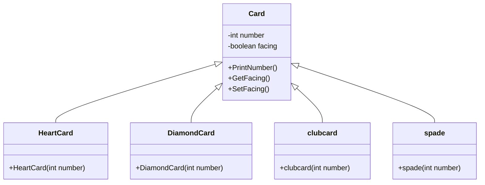

# Blackjack Card Simulation — Java Inheritance & Polymorphism

A Java object-oriented programming demonstration modeling card decks and suit variations using class inheritance, method overriding, and polymorphic behavior.

---

## 📌 Project Overview

This project explores Object-Oriented Programming (OOP) in Java with a card deck context:
- **Inheritance Hierarchy:** A base `Card` class extended by suit-specific derived classes (`HeartCard`, `DiamondCard`, `clubcard`, `spade`).
- **Encapsulation:** State management tracking whether a card is face-up or face-down (`GetFacing()`, `SetFacing()`).
- **Polymorphism:** Overriding card display and property behaviors across different suits.
- **Deck Array Management:** Populating a fixed-size 52-card array dynamically using iteration and suit partition counters.

---

## 🏗️ Class Hierarchy



---

## 📂 Repository Structure

```text
Prakruthi_BlackJack/
├── Card.java          # Base card class with facing state and value logic
├── HeartCard.java     # Subclass extending Card for Heart suit
├── DiamondCard.java   # Subclass extending Card for Diamond suit
├── clubcard.java      # Subclass extending Card for Club suit
├── spade.java         # Subclass extending Card for Spade suit
├── Main.java          # Driver program to build deck and verify facing cards
└── README.md          # Project documentation
```

---

## ⚙️ Compilation & Execution

### Prerequisites
- Java Development Kit (JDK 8 or higher)

### Steps to Run:

1. **Clone the repository:**
   ```bash
   git clone https://github.com/prakruthidevanga/Prakruthi_BlackJack.git
   cd Prakruthi_BlackJack
   ```

2. **Compile the classes:**
   ```bash
   javac *.java
   ```

3. **Run the program:**
   ```bash
   java Main
   ```

---

## 👩‍💻 Author & Contributions

- **Author:** Prakruthi B R ([@prakruthidevanga](https://github.com/prakruthidevanga))
- **Role:** Individual developer — designed OOP inheritance hierarchy and deck generation logic.
